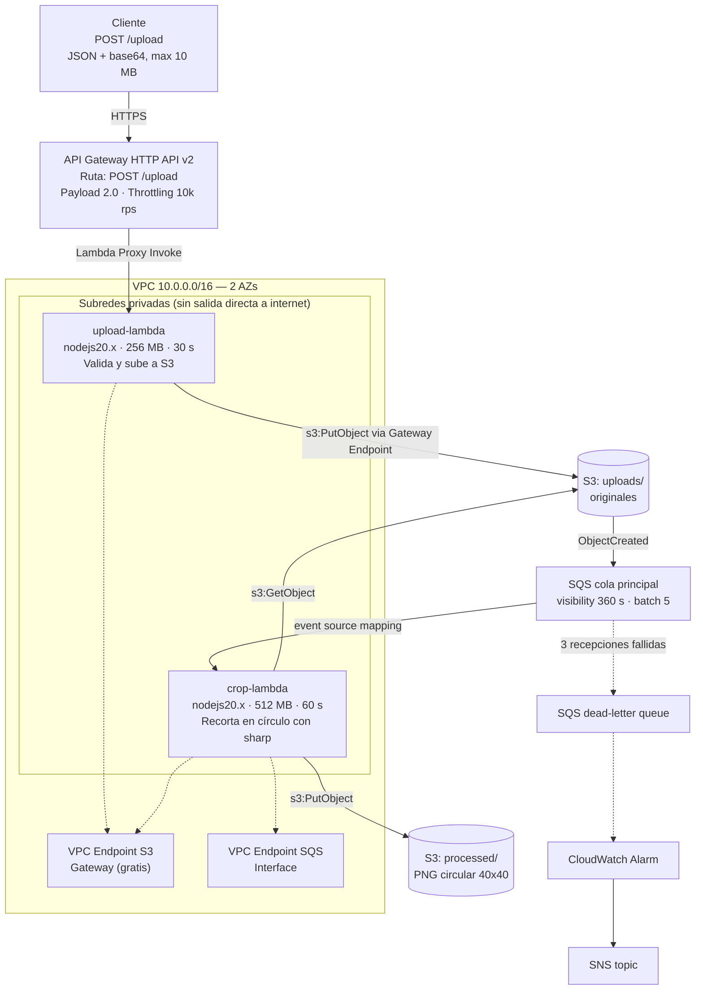

# Image Processor — AWS + Lambda Integration

Infraestructura como código (Terraform) para un pipeline serverless de procesamiento de
imágenes sobre AWS. El sistema recibe una imagen por HTTP, la almacena, y de forma
asíncrona genera una versión recortada en círculo de 40×40 px con fondo transparente.

Desplegable en **tres entornos independientes**: `dev`, `qa` y `prod`.

---

## Tabla de contenidos

- [Arquitectura](#arquitectura)
- [Stack tecnológico](#stack-tecnológico)
- [Estructura del repositorio](#estructura-del-repositorio)
- [Prerrequisitos](#prerrequisitos)
- [Despliegue](#despliegue)
- [Uso de la API](#uso-de-la-api)
- [Destrucción de recursos](#destrucción-de-recursos)
- [Diseño multi-entorno](#diseño-multi-entorno)
- [Decisiones de diseño](#decisiones-de-diseño)
- [Hallazgos sobre el diagrama de referencia](#hallazgos-sobre-el-diagrama-de-referencia)
- [Convención de commits](#convención-de-commits)
- [Costos](#costos)
- [Solución de problemas](#solución-de-problemas)

---

## Arquitectura



### Flujo de datos

1. El cliente hace `POST /upload` con la imagen en base64.
2. API Gateway invoca `upload-lambda` (integración proxy, payload 2.0).
3. La Lambda valida tipo y tamaño, y escribe el original en `s3://<bucket>/uploads/`.
4. S3 emite una notificación `ObjectCreated` hacia la cola SQS principal.
5. El event source mapping dispara `crop-lambda` con lotes de 5 mensajes.
6. La Lambda descarga el original, lo recorta en círculo de 40×40 px con `sharp`, y sube
   el PNG resultante a `s3://<bucket>/processed/`.
7. Si un mensaje falla 3 veces, pasa a la dead-letter queue, lo que dispara una alarma
   de CloudWatch y una notificación por SNS.

---

## Stack tecnológico

| Componente | Servicio |
|---|---|
| Cómputo | AWS Lambda (Node.js 20.x) |
| Entrada | API Gateway HTTP API v2 |
| Almacenamiento | Amazon S3 (SSE-S3, versionado) |
| Mensajería | Amazon SQS (cola estándar + DLQ) |
| Red | VPC, 2 AZs, subredes públicas y privadas, NAT Gateway por AZ |
| Conectividad privada | VPC Endpoints: S3 (Gateway) y SQS (Interface) |
| Identidad | IAM con roles de mínimo privilegio |
| Observabilidad | CloudWatch Logs, CloudWatch Alarm, SNS |
| IaC | Terraform >= 1.5, AWS provider ~> 5.0 |
| Procesamiento de imagen | `sharp` 0.33.4 (binarios nativos linux-x64) |

---

## Estructura del repositorio

```
.
├── environments/              # Valores por entorno
│   ├── dev.tfvars
│   ├── qa.tfvars
│   └── prod.tfvars
├── src/                       # Código de las funciones Lambda
│   ├── upload/
│   │   ├── index.mjs
│   │   ├── package.json
│   │   ├── Dockerfile         # Construye node_modules con binarios linux-x64
│   │   └── .dockerignore
│   └── crop/
│       ├── index.mjs
│       ├── package.json
│       ├── Dockerfile
│       └── .dockerignore
├── build.ps1 / build.sh       # Scripts de empaquetado de dependencias
├── versions.tf                # Versiones de Terraform y providers
├── providers.tf               # Provider AWS y default_tags
├── variables.tf               # Variables de entrada
├── locals.tf                  # Nombres derivados y configuración por entorno
├── random.tf                  # Sufijo aleatorio para unicidad del bucket
├── network.tf                 # VPC, subredes, IGW, NAT, route tables
├── security.tf                # Security groups
├── endpoints.tf               # VPC endpoints de S3 y SQS
├── storage.tf                 # Bucket S3 y sus configuraciones
├── messaging.tf               # Colas SQS y política
├── iam.tf                     # Roles y políticas
├── lambda.tf                  # Funciones, event source mapping, notificación S3
├── api.tf                     # API Gateway HTTP v2
├── observability.tf           # Log groups, alarma y SNS
└── outputs.tf                 # Outputs (incluye la URL del proyecto)
```

---

## Prerrequisitos

| Herramienta | Versión mínima | Verificación |
|---|---|---|
| Terraform | 1.5.0 | `terraform version` |
| AWS CLI | v2 | `aws --version` |
| Docker | 20+ | `docker --version` |
| Node.js | 20 (opcional, solo para pruebas locales) | `node --version` |

### Credenciales de AWS

Se requiere un usuario IAM con credenciales configuradas:

```bash
aws configure
aws sts get-caller-identity
```

El provider de AWS toma las credenciales automáticamente desde `~/.aws/credentials`.
**No se hardcodean credenciales en ningún archivo del repositorio.**

### Permisos requeridos

Terraform realiza operaciones de **descubrimiento** además de creación, por lo que necesita
permisos de lectura amplios. Los servicios requeridos son:

`ec2` (VPC, subredes, NAT, IGW, endpoints, security groups) · `s3` · `sqs` · `lambda` · `iam` ·
`apigateway` · `logs` · `cloudwatch` · `sns` · `sts`

---

## Despliegue

### Paso 1 — Empaquetar las dependencias de las Lambda

```powershell
.\build.ps1
```

```bash
./build.sh
```

> **Por qué este paso es obligatorio.** `sharp` incluye binarios nativos compilados por
> plataforma. Instalarlo en Windows produce binarios `win32-x64`, que **no cargan** en
> Lambda (Linux x64) y provocan el error
> `Could not load the sharp module using the linux-x64 runtime` en tiempo de ejecución.
> Los scripts construyen las dependencias dentro de un contenedor con la misma imagen
> que usa AWS Lambda (`public.ecr.aws/lambda/nodejs:20`), garantizando binarios correctos.
>
> Verificación: `ls src/crop/node_modules/@img` debe mostrar `sharp-linux-x64` y
> `sharp-libvips-linux-x64`.

### Paso 2 — Inicializar Terraform y crear los workspaces

```bash
terraform init
terraform workspace new dev
terraform workspace new qa
terraform workspace new prod
```

### Paso 3 — Desplegar un entorno

```bash
terraform workspace select dev
terraform plan  -var-file environments/dev.tfvars
terraform apply -var-file environments/dev.tfvars
```

> **Regla de oro:** el nombre del workspace debe coincidir con el valor de `environment`
> en el archivo `.tfvars`. Verifica siempre con `terraform workspace show` antes de aplicar.
>
> **Nunca tener los tres entornos desplegados a la vez.** Aplica, valida, captura y
> destruye cada entorno de forma secuencial.

### Paso 4 — Obtener la URL del proyecto

```bash
terraform output api_invoke_url
```

---

## Uso de la API

**Endpoint:** `POST <api_invoke_url>`

> **URL del despliegue de referencia:** `https://<id>.execute-api.us-east-1.amazonaws.com/upload`
> _(placeholder — reemplazar con la salida real de `terraform output api_invoke_url`)_

### Formato de la petición

```json
{
  "filename": "foto.png",
  "contentType": "image/png",
  "data": "<contenido del archivo codificado en base64>"
}
```

**Restricciones:** máximo 10 MB. Tipos permitidos: `image/jpeg`, `image/png`, `image/gif`,
`image/webp`.

### Ejemplo con curl

```bash
# Codificar la imagen
B64=$(base64 -w0 prueba.png)

curl -X POST "$(terraform output -raw api_invoke_url)" \
  -H "Content-Type: application/json" \
  -d "{\"filename\":\"prueba.png\",\"contentType\":\"image/png\",\"data\":\"$B64\"}"
```

### Ejemplo con PowerShell

```powershell
$url = terraform output -raw api_invoke_url
$b64 = [Convert]::ToBase64String([IO.File]::ReadAllBytes(".\prueba.png"))
$body = @{ filename = "prueba.png"; contentType = "image/png"; data = $b64 } | ConvertTo-Json -Compress
curl.exe -X POST $url -H "Content-Type: application/json" -d $body
```

### Respuesta exitosa (HTTP 200)

```json
{
  "message": "Archivo subido correctamente. El procesamiento es asincrono.",
  "bucket": "image-processor-dev-images-xxxxxxxx",
  "key": "uploads/xxxxxxxx-xxxx-xxxx-xxxx-xxxxxxxxxxxx.png",
  "sizeBytes": 3421,
  "contentType": "image/png"
}
```

Tras unos segundos, el resultado aparece en `processed/<nombre>_circular.png` dentro del
bucket. El procesamiento es **asíncrono**: la respuesta HTTP no espera al recorte.

### Respuestas de error

| Código | Causa |
|---|---|
| `400` | Falta el archivo, el tipo no está permitido, o el archivo está vacío |
| `413` | El archivo supera los 10 MB |
| `500` | Error interno al escribir en S3 |

---

## Destrucción de recursos

```bash
terraform workspace select dev
terraform destroy -var-file environments/dev.tfvars
```

### Verificación de destrucción completa

```bash
aws ec2 describe-vpcs --filters "Name=tag:Project,Values=image-processor" --query "Vpcs[].VpcId"
aws s3api list-buckets --query "Buckets[?contains(Name,'image-processor')].Name"
aws lambda list-functions --query "Functions[?contains(FunctionName,'image-processor')].FunctionName"
aws sqs list-queues --queue-name-prefix image-processor
```

Los cuatro comandos deben devolver vacío.

### Caso especial: entorno `prod`

`prod.tfvars` define `deletion_protection = true`, por lo que `terraform destroy` **fallará
intencionalmente**. Es una protección contra borrado accidental. Para destruirlo:

```bash
# 1. Editar environments/prod.tfvars: deletion_protection = false
# 2. Aplicar el cambio
terraform apply -var-file environments/prod.tfvars
# 3. Ahora sí, destruir
terraform destroy -var-file environments/prod.tfvars
```

---

## Diseño multi-entorno

Se utilizan **workspaces de Terraform** con state local. Cada workspace guarda su propio
state en `terraform.tfstate.d/<workspace>/terraform.tfstate`, por lo que los entornos
están completamente aislados: operar en `dev` no afecta a `qa` ni a `prod`.

El código es **idéntico** para los tres entornos. Lo único que cambia son los valores en
`environments/*.tfvars`:

| Variable | dev | qa | prod |
|---|---|---|---|
| `nat_gateway_count` | 2 | 2 | 2 |
| `log_retention_days` | 14 | 14 | 14 |
| `force_destroy_bucket` | true | true | **false** |
| `deletion_protection` | false | false | **true** |

Las diferencias se limitan a las **protecciones operativas**, que el diagrama no especifica.
La arquitectura (cantidad de NAT Gateway, retención de logs) es fiel al diagrama en los
tres entornos.

### Convención de nombres

Todos los recursos llevan el prefijo `<project_name>-<environment>`:

```
image-processor-dev-vpc
image-processor-dev-upload
image-processor-dev-image-queue
image-processor-dev-images-a3f9b2c1     # sufijo aleatorio por unicidad global de S3
```

Todos los recursos reciben automáticamente las etiquetas `Project`, `Environment`,
`ManagedBy` y `Workspace` mediante `default_tags` del provider. Eso permite **filtrar
costos por entorno** en Cost Explorer.

### Guardas de seguridad implementadas

1. **Variables sin valor por defecto.** `nat_gateway_count`, `log_retention_days`,
   `force_destroy_bucket` y `deletion_protection` no tienen `default`. Si se omite el
   `-var-file`, el plan falla en lugar de desplegar una configuración incorrecta.
2. **Validación de entorno.** La variable `environment` solo acepta `dev`, `qa` o `prod`.
3. **Fail-safe de workspace.** Si se ejecuta en el workspace `default`, el lookup
   `local.env_table[terraform.workspace]` falla de inmediato.
4. **Validación cruzada (bloqueante).** El output `entorno_validado` incluye una
   `precondition` que aborta la ejecución si `var.environment` no coincide con
   `terraform.workspace`. Detecta el caso peligroso de aplicar `dev.tfvars` estando en el
   workspace `prod`, que crearía recursos con el nombre de un entorno y la configuración
   de otro.

   ```
   Error: Module output value precondition failed
   DESALINEADO: el workspace activo es 'qa' pero el -var-file declara environment='dev'.
   Ejecuta 'terraform workspace select dev' antes de continuar.
   ```

---

## Decisiones de diseño

### Un bucket con dos prefijos, no dos buckets

El diagrama distingue `uploads/` y `processed/`, pero **son prefijos del mismo bucket**.
Se implementan como dos reglas de ciclo de vida sobre un solo `aws_s3_bucket`:

- `uploads/` → expira a los 30 días
- `processed/` → expira a los 90 días

Crear dos buckets duplicaría cifrado, versionado, bloqueo de acceso público y políticas
sin ningún beneficio.

### "Réplicas" de Lambda: una función con ENIs en dos AZs

El diagrama dibuja `upload-lambda` y `upload-lambda replica AZ-b`. **No son dos funciones.**
Una función Lambda despliega sus interfaces de red en todas las subredes que se le indiquen:

```hcl
vpc_config {
  subnet_ids         = aws_subnet.private[*].id   # ambas AZs
  security_group_ids = [aws_security_group.lambda_upload.id]
}
```

Son **2 funciones** (`upload` y `crop`), no 4, con alta disponibilidad real.

### NAT Gateway parametrizable

`nat_gateway_count` permite 0, 1 o 2 NAT Gateway. El valor por defecto en los tres entornos
es **2**, para alta disponibilidad fiel al diagrama: cada route table privada enruta por el
NAT de su propia AZ, eliminando el punto único de falla.

Con `0`, las rutas privadas simplemente no se crean y las Lambdas siguen funcionando: S3 y
SQS se alcanzan íntegramente por VPC endpoints. La variable existe para poder ajustar el
costo sin modificar código.

### `--no-bin-links` en el empaquetado

`npm install` crea `node_modules/.bin/` con enlaces simbólicos, que el sistema de archivos
de Windows no permite crear sin privilegios elevados, haciendo fallar la exportación desde
el contenedor. Dado que `.bin` **no se utiliza en tiempo de ejecución de Lambda**, se
desactiva con `--no-bin-links`, eliminando la causa en lugar del síntoma.

### Política adicional en la cola SQS

El diagrama no incluye la política de la cola, pero **S3 la necesita** para poder enviar
notificaciones. Incluye una condición `aws:SourceArn` que restringe el envío al bucket
del proyecto, evitando que cualquier bucket de cualquier cuenta pueda escribir en la cola.

---

## Hallazgos sobre el diagrama de referencia

Durante la implementación se identificaron cinco puntos del diagrama que requirieron
decisión o corrección:

| # | Hallazgo | Resolución |
|---|---|---|
| 1 | La alarma menciona "notify via SNS topic" pero **no dibuja el topic** | Se crea `aws_sns_topic` + suscripción por correo |
| 2 | "Outbound: TCP 443 to vpce-s3 and vpce-sqs" es **inejecutable literalmente**: el S3 Gateway Endpoint no tiene security group (es una entrada de route table, no tiene ENI) | El control de acceso a S3 se hace con IAM + política del endpoint; el SG de egreso apunta solo al endpoint de SQS |
| 3 | Las "réplicas" de Lambda en AZ-b **no son recursos separados** | Una función con `subnet_ids` en ambas subredes privadas |
| 4 | Los dos prefijos de S3 (`uploads/`, `processed/`) **no son dos buckets** | Un bucket con dos reglas de ciclo de vida |
| 5 | Falta la **política de la cola SQS** que S3 requiere para notificar | Se agrega `aws_sqs_queue_policy` con condición `aws:SourceArn` |

---

## Convención de commits

Este proyecto sigue [Conventional Commits](https://www.conventionalcommits.org/).

**Formato:** `<tipo>(<alcance>): <descripción en imperativo>`

El tipo y el alcance se escriben en inglés (son palabras reservadas de la convención);
la descripción en español.

- **Tipos:** `feat`, `fix`, `chore`, `docs`, `refactor`, `style`
- **Alcances:** `terraform`, `red`, `seguridad`, `endpoints`, `s3`, `sqs`, `iam`, `lambda`,
  `api`, `observabilidad`, `docs`

**Ejemplos del historial:**

```
feat(red): agrega vpc, subredes, igw, nat gateways y tablas de rutas en dos az
feat(s3,sqs): agrega bucket con cifrado y ciclo de vida, y colas sqs con dlq y politica
feat(iam): agrega roles y politicas de minimo privilegio para las lambdas
feat(api,observabilidad): agrega http api v2, log groups, alarma dlq y outputs
```

---

## Costos

El costo está dominado por tres componentes que **cobran por hora de existencia**:

| Recurso | Precio aproximado | Mensual |
|---|---|---|
| NAT Gateway | $0.045/hora + $0.045/GB | ~$32 |
| Elastic IP (IPv4 pública) | $0.005/hora | ~$3.60 |
| VPC Interface Endpoint (SQS) | $0.01/hora por AZ | ~$14.40 (2 AZs) |

**Costo estimado por entorno: ~$50/mes si se deja corriendo.**

El resto de los servicios (Lambda, API Gateway, S3, SQS, CloudWatch, SNS) opera dentro del
free tier para el volumen de pruebas de este proyecto.

**Gestión de costo aplicada:** dado que el enunciado requiere evidenciar la destrucción de
los recursos, los entornos se despliegan de forma **secuencial** (uno a la vez) y se
destruyen tras la validación. El costo real de completar este proyecto es del orden de
**unos pocos dólares**.

> **Recomendación operativa:** configurar un presupuesto en AWS Budgets con alerta a los
> $5 para detectar cualquier recurso que quede activo por error. Activar además las
> etiquetas de asignación de costos (`Project`, `Environment`, `Workspace`) para poder
> desglosar el gasto por entorno en Cost Explorer.

---

## Solución de problemas

### `Could not load the sharp module using the linux-x64 runtime`

Los `node_modules` se construyeron para Windows. Vuelve a empaquetar:

```bash
./build.sh      # o .\build.ps1 en Windows
```

Verifica que exista `src/crop/node_modules/@img/sharp-linux-x64`.

### `Error: Invalid index` en `local.env_table[terraform.workspace]`

Estás en el workspace `default`. Selecciona un entorno válido:

```bash
terraform workspace select dev
```

### `Error: No value for required variable`

Falta el `-var-file`:

```bash
terraform plan -var-file environments/dev.tfvars
```

### `BucketAlreadyExists`

El nombre del bucket ya está tomado globalmente. El sufijo `random_id` lo evita; si aparece
este error, fuerza la regeneración:

```bash
terraform apply -replace="random_id.bucket_suffix" -var-file environments/dev.tfvars
```

### `ResourceAlreadyExistsException` en los log groups

Terraform creó la función Lambda antes que su log group, y Lambda creó el grupo primero.
Los `depends_on` en `lambda.tf` lo previenen. Si ya ocurrió:

```bash
terraform import aws_cloudwatch_log_group.upload_lambda /aws/lambda/image-processor-dev-upload
```

### El `destroy` falla con `BucketNotEmpty`

`force_destroy_bucket` está en `false` (es el valor de `prod`). Vacía el bucket o cambia el
valor a `true`.

### `symlinkat ... El cliente no dispone de un privilegio requerido` al construir

Falta `--no-bin-links` en el `RUN npm install` del `Dockerfile`.

### `Too many command line arguments` con `terraform plan`

El shell de Windows interpreta mal el `=` en flags con rutas. Usa espacio en lugar de `=`:

```bash
terraform plan -var-file environments/dev.tfvars     # correcto
terraform plan -var-file=environments/dev.tfvars     # puede fallar en Windows
```
